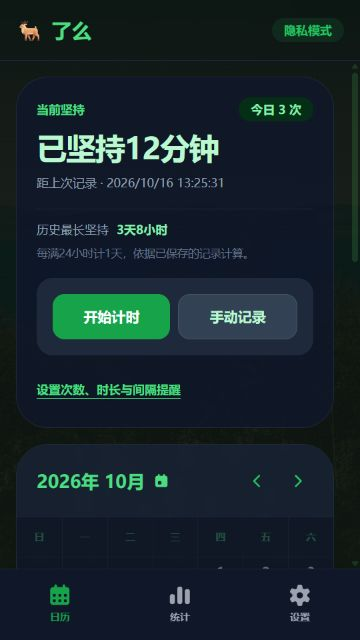
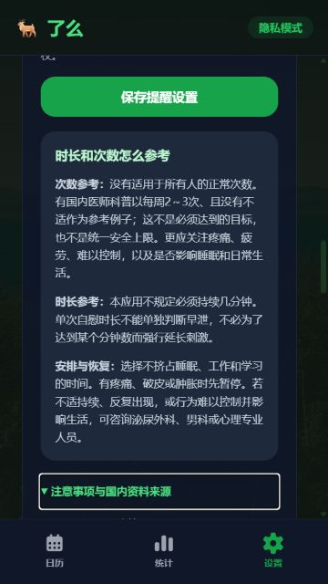
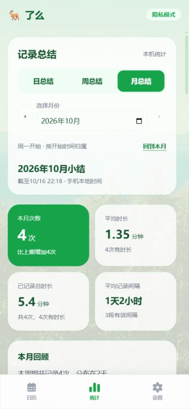
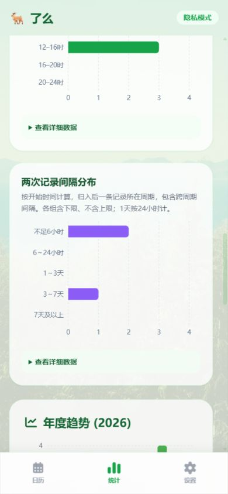

# 鹿了么 · 个人增强版

基于 [mengkuikun/luleme-app](https://github.com/mengkuikun/luleme-app) 二次开发的本地习惯记录应用。在原有日历、统计和隐私功能上，增加坚持时长、后台计时、次数／时长／间隔提醒、国内健康科普和记录编辑。

**原作者：[mengkuikun](https://github.com/mengkuikun) 及原项目贡献者。感谢原作者开放源码。**

本仓库由 [chishao409](https://github.com/chishao409) 维护，使用独立私人签名。保留原项目的 [MIT 许可证及版权声明](LICENSE)。

当前版本：`1.8.0-private.1`

[下载安卓安装包](https://github.com/chishao409/lulemo-personal/releases/tag/v1.8.0-private.1) · [详细使用和构建说明](docs/private-release.md) · [原项目](https://github.com/mengkuikun/luleme-app)

## 相较原版增加了什么

对比基准为原项目 1.6.3 / 本次获取的 main 源码快照。

| 功能 | 原版基础 | 个人增强版 |
| --- | --- | --- |
| 当前坚持时长 | 没有独立展示 | 首页显示距最近记录的时长，每满24小时计1天 |
| 历史最长坚持 | 没有独立展示 | 计算历史最长记录间隔，包含当前这段；超过时显示新纪录 |
| 次数提醒 | 冷却时间控制 | 自设每日次数，首次达到或超过时提醒，每天最多一次 |
| 时长与间隔提醒 | 可填写持续时长 | 自设单次时长下限、两次开始时间间隔，分别开启提醒 |
| 手机通知 | 没有相应原生插件 | 应用内提示与安卓通知，中性摘要、权限拒绝时保留应用内提示 |
| 计时器 | 手填时长与快捷选项 | 保留手填；增加开始／结束计时、后台与锁屏后恢复、结束后确认保存 |
| 准确发生时间 | 记录保存时间戳，补录可选日期 | 补录和编辑可指定日期与几点几分 |
| 编辑记录 | 支持补录、删除 | 保留这些功能，增加完整编辑，次数和间隔随之重算 |
| 两次之间的间隔 | 没有独立展示 | 历史记录卡片显示与前一条记录的间隔 |
| 冷却期 | 阻止继续打卡 | 改为可跳过的提示，可选择仍然记录 |
| 时长备份精度 | CSV 导入时按整数分钟处理 | 保留小数分钟，不足一分钟的计时可完整往返 |
| 健康科普 | 没有相应说明 | 提供国内资料、注意事项，以及时长和次数的参考方式 |
| 日／周／月小结 | 年度次数趋势与日历热力图 | 在统计页增加历史周期选择、有效时长指标、本机文字总结与同进度对比 |
| 多维统计图表 | 次数年度分布 | 增加次数趋势、持续时长趋势、发生时段分布、间隔分布；提供详细数据表 |
| 年度统计口径 | 年度卡片混入其他年份记录 | 统一使用当年有效记录，保留原有年度趋势和热力图 |

## 原有功能继续保留

日历记录、年度趋势和热力图、心情与备注、主题和自定义背景、图标与音效、PIN／生物识别、CSV 导入导出、WebDAV 备份。

## 坚持和提醒的计算规则

- 坚持时长根据已保存记录的**开始时间**计算，新增记录后重新计时；漏记可补录修正。它表示记录间隔，不用于评价身体健康。
- 首次没有记录时显示“暂无记录”。历史最长不推算第一条记录之前的时间。
- 每日统计按手机本地日期划分。计时跨午夜时计入开始那天。
- 今天的新增或编辑记录可触发提醒；历史补录、导入和删除不弹提醒。当日已经发出的次数提醒不会因删改而重置。
- 多个条件命中时合并为一次提示；通知栏只显示摘要，应用内查看详情。
- 提醒初始关闭，由使用者分别开启并填写阈值。设置保存后生效；不会追补旧提醒。
- 计时状态保存在本机，通过开始／结束时间恢复，不依赖应用在后台持续执行。

## 日／周／月总结（1.8 新增）

在底部“统计”页查看，默认本月。可切换日／周／月、前后翻页或选择历史日期；周从周一开始。首页继续保留原有布局。

- 指标包括次数、已记录总时长、平均时长和平均记录间隔；注明“共几次、几次有时长”。未填或无效时长不当作0，也不计入平均值。
- 四类图表覆盖次数趋势、持续时长趋势、发生时段和记录间隔。日趋势按小时，周／月按天；各图可查看精确数据表。
- 当前周期与上期相同日历进度比较；已结束的历史周期比较完整周期。上期为0时仅显示增减次数，不计算百分比。
- 间隔由两次开始时间相减，归入后一条记录所在周期，包含跨周期间隔；第一条历史记录没有前次，排除。
- 文字总结完全在本机按规则生成，说明现有数据、缺失时长和集中时段；不上传记录，不进行疾病诊断。
- 年度累计已修正为当年有效记录，全年月平均明确为年度次数除以12。

完整分组、时间边界和对比规则见 [统计口径](docs/statistics.md)。

## 关于时间、次数与健康提示

没有适用于所有人的固定正常次数。国内医生科普中的“每周2～3次、且没有不适”仅是参考例子，不是必须达到的目标或统一安全上限。应结合疼痛、疲劳、控制感，以及是否影响睡眠和日常生活判断。

本应用不规定必须持续几分钟，也不根据单次自慰时长判断早泄。有疼痛、破皮或肿胀时暂停刺激；不适持续、反复出现或行为明显影响生活时咨询专业医生。

应用内的阅读来源使用国内网站，已核对于2026-10-16：

- [中山市博爱医院：次数与过度的判断](https://www.zsboai.com/department_szyxzxa0_ksdt/2026/DdwkqRd1.html)
- [中国医药信息查询平台：北大医院彭靖医师谈频率](https://www.dayi.org.cn/qa/51054)
- [中国医药信息查询平台：自慰与注意事项](https://www.dayi.org.cn/symptom/1151996.html)
- [好大夫在线：河北省中医院医师谈时长与评估](https://www.haodf.com/neirong/wenzhang/6093153447.html)

提示用于个人习惯管理和一般科普，阈值是个人设置，不是医学诊断。

## 安装与旧数据迁移

**已安装本仓库 1.7.0-private.1 的用户：先备份，再直接覆盖安装 1.8.0-private.1，无需卸载；本次沿用同一私人签名并递增版本号。**

首次使用私人版，请按以下顺序操作：

1. 在原版导出 CSV，并通过“分享文件”把备份保存到电脑或独立于原应用的目录。
2. 确认备份文件存在、可打开，且包含原记录。
3. 卸载原版，安装本仓库 Release 中的 APK。
4. 进入设置的数据管理，导入 CSV，核对记录数量、日期与时长。
5. 重新设置 PIN、主题和各类提醒，需要手机通知时开启并授权。

私人版保留包名 `com.lulemo.app`，与官方签名不同，不能直接覆盖官方版。后续私人版更新会使用同一私人签名，可在私人版上覆盖安装。

CSV / WebDAV 迁移记录，不包含主题、PIN、提醒设置或未完成计时。源码和发布包不包含签名私钥、密码或个人记录。

## 界面预览

以下截图使用开发时生成的测试记录，APK 不包含这些记录。

<p>
  
  
  
  
</p>

## 本地开发与构建

技术栈为 React、TypeScript、Vite、Capacitor。需要 Node/npm、JDK 17或21、Android SDK Platform 35 和 Build Tools 34.0.0。

```powershell
npm ci
npm run dev
```

检查与安卓构建：

```powershell
npm run typecheck
npm test
npm run build
npx cap sync android
.\scripts\prepare-signing.ps1
cd android
.\gradlew.bat :app:assembleRelease
```

签名脚本在本机生成或复用私人密钥，默认保存在 `%USERPROFILE%\.lulemo-private-signing`，不会提交到仓库。自行构建的人应保留自己的密钥备份，并使用自己的签名维护后续版本。

## 验证情况

- TypeScript 类型检查、95项自动测试、网页生产构建通过；统计边界另外在夏令时时区验证。
- 安卓 Release 构建通过，APK 签名已验证。
- 已在手机尺寸的浏览器中检查记录编辑、坚持时长、计时恢复、冷却提示、阈值校验、合并提醒，以及日周月切换、历史与空周期、数据表和浅／深色统计布局。
- 当前没有连接安卓测试设备；系统通知权限、锁屏恢复和原版数据迁移仍需实际手机验证。

## 致谢与许可证

原项目：[mengkuikun/luleme-app](https://github.com/mengkuikun/luleme-app)。日历、统计、隐私、导入导出和 WebDAV 等基础能力来自原作者及贡献者。

本次新增功能和修改点见上方对比表。沿用 [MIT License](LICENSE)，保留原始版权声明。
